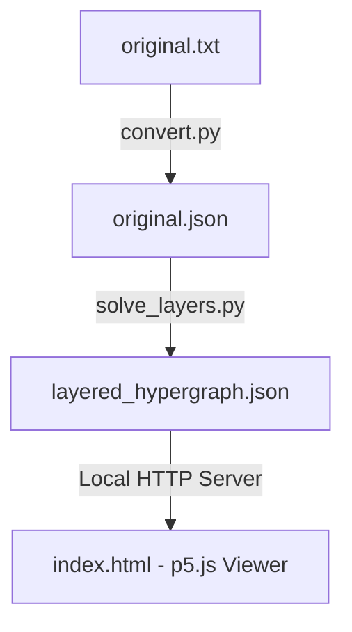

# Layered Hypergraph Drawing Visualizer

This project is a complete pipeline for assigning layers (Z-levels) to hyperedges in a hypergraph to avoid overlapping polygons, and rendering them in an interactive 2.5D 3D space.

The system consists of three main components:
1. **Data Converter (`convert.py`)**: Converts raw hypergraph text data (`original.txt`) to structured JSON format (`original.json`).
2. **Layer Assignment Solver (`solve_layers.py`)**: Computes shared vertex weights and overlap constraints, determines layout ordering using Spectral Layout (Fiedler vector), and optimizes layer coordinates using a strictly convex QP formulation solved via SciPy.
3. **Interactive 2.5D Viewer (`index.html`)**: An interactive 3D WebGL-based visualizer built using p5.js, featuring translucent polygons, node spheres, vertical connector lines, search filtering, and hover tooltips.

---

## Architecture Diagram



---

## Installation & Setup

1. **Set up a Python Virtual Environment**:
   ```bash
   # Create a localized virtual environment
   python3 -m venv .venv

   # Activate the virtual environment
   source .venv/bin/activate
   ```

2. **Install Required Python Dependencies**:
   ```bash
   pip install numpy scipy shapely
   ```

---

## Detailed Usage Pipeline

### Step 1: Convert Text Data to JSON
Parse raw data from `original.txt` (containing node locations and hyperedge definitions) into structured JSON format `original.json`:
```bash
python convert.py
```

### Step 1b: Optimize the polygon coordinates

Run the polygon optimizer before assigning heights:

```powershell
.\.venv\Scripts\python.exe solve_polygon_layout.py
```

With no arguments, both input and output are `original.json`. The input is backed
up as `original_before_polygon_layout.json` (or a unique additional backup)
before replacement. IDs, all memberships including repeated IDs, labels, colors,
and other metadata are preserved. Each node has one shared XY coordinate.

The new implementation uses Qu et al.'s unnormalized PR/PA/PS/PI energies,
convex-hull-centroid starrization, L-BFGS, and exhaustive within-face coordinate
pair swaps. `--dual` additionally optimizes the dual view and DD energy. Hu
initialization uses Graphviz `sfdp`; the former approximate force initializer
and cardinality-normalized objective have been removed.

The default `--mode scalable` uses a bipartite Hu initialization, records a paper
objective baseline, and then adds global regular-polygon consensus, a regular
polygon fitting term, a convex-hull area deficit penalty and short-range vertex
repulsion. These extensions help high-cardinality faces retain their outlines.
They are distinct from the topology-changing simplifiers in the 2023/2024 papers.
See [the Japanese implementation and source audit](polygon_layout_reproduction.md)
for equations, settings, reproduction scope, and geometric limitations.

Requirements: Python with `numpy scipy shapely`, Graphviz including `sfdp`, and a
C++17-capable `g++`. The Python entry point automatically compiles
`polygon_kernel.cpp` into a cached shared library in `.polygon_cache/` on first
use. **Run the Python script, not the C++ file as an executable.** On this Windows
installation Graphviz is also discovered in `Program Files (x86)/Graphviz/bin`.
Use `--sfdp PATH` for another installation.

To save a candidate separately, or run only the paper coordinate objective:

```powershell
.\.venv\Scripts\python.exe solve_polygon_layout.py original.json candidate.json --report candidate_report.json --preview candidate.svg
.\.venv\Scripts\python.exe solve_polygon_layout.py original.json paper.json --mode paper --initialization hu-clique --report paper_report.json --preview paper.svg
.\.venv\Scripts\python.exe -m unittest test_solve_polygon_layout -v
```

Available initializations: `hu-clique`, `hu-bipartite`, `input`, `circular`, and
`random`. `--initial-layout FILE --initialization input` warm-starts from another
JSON with identical IDs and memberships. `--iterations 600 --max-cycles 6` are the
default budgets per phase. `--fit-weight 1 --convexity-weight 10
--collision-weight 0.05` control only the scalable extension. Budget exhaustion
is reported separately from convergence; regular polygons are not guaranteed
for arbitrary shared memberships.

`polygon_layout_report.json` records whole-graph and per-face regularity ratios
(1 is ideal), concavity, hull deficits, actual polygon overlap counts, stages,
weights and initializer versions. `polygon_layout_comparison.svg` compares the
largest faces and representative smaller ones, retaining all member vertices.
Inspect both shape and overlap metrics: improving shape can increase overlaps.
An optional PNG including the full graph can be rendered with matplotlib:

```powershell
.\.venv\Scripts\python.exe plot_polygon_comparison.py original_before_polygon_layout.json original.json polygon_layout_comparison.png
```

The source remains the existing JSON; this command does not reimport
`masuta.csv` or repair earlier parsing changes. Regenerate layer assignments
after changing XY, since their overlap constraints refer to the previous
geometry. Running `convert.py` again restores the text export's coordinates.
The earlier `original_polygon_candidate*.json` files are historical experiments.

### Step 2: Run the Layer Assignment Optimization
Perform the 2-phase layer assignment algorithm to determine optimal Z-levels for each hyperedge:
```bash
python solve_layers.py
```
This script runs the following optimization flow:
- **Constraint Extraction**: Uses `shapely` to construct 2D polygons by connecting nodes in their exact defined order for each hyperedge and identify the overlap set $C$ (where intersection area $> 10^{-9}$).
- **Phase 1: Spectral Layout**: Builds the graph Laplacian of shared vertex weights $W$ (regularized by $\epsilon = 10^{-5}$ to ensure connectivity). Computes the Fiedler vector (eigenvector of the second-smallest eigenvalue) to determine a strict stable sorted order.
- **Phase 2: Convex QP**: Sets up a strictly convex QP on a reduced system of $N-1$ variables by eliminating the anchor constraint ($x_0 = 0$). The objective is scaled for numerical stability and solved via `scipy.optimize.minimize(method='SLSQP')` to ensure $|x_i - x_j| \ge 1.0$ for all overlapping pairs $(i, j) \in C$.
- Output is stored in `layered_hypergraph.json`.

### Step 3: Run the Visualizer
Start a local HTTP web server to serve the viewer files:
```bash
python -m http.server 8080 --bind 127.0.0.1
```
Open your browser and navigate to:
```
http://127.0.0.1:8080/index.html
```

---

## Viewer Features & Controls

The p5.js-based 2.5D visualizer runs in WebGL mode and provides several controls for exploration:

*   **Interactive 3D Viewport**: Left-click and drag to rotate the scene, right-click and drag to pan, and scroll to zoom in/out.
*   **Vertical & Horizontal Scale**: Slide controls allow adjusting the horizontal spacing (XY scale) and the vertical spacing between layers (Z scale).
*   **Translucent Polygons**: Hyperedges are drawn as filled, color-coded translucent polygons representing their node-order outlines.
*   **Vertical Connector Lines**: Nodes shared by multiple hyperedges are linked across layers using vertical pillars.
*   **Auto-Rotation**: Toggles a slow, continuous rotation of the 3D canvas for a dynamic visualization.
*   **Search Filter**: Input terms to filter and highlight matching nodes/edges (e.g. search for `TTF-1` to highlight that specific hyperedge).
*   **Details on Hover**: Projected 3D-to-2D coordinates dynamically trace the mouse position. Hovering over nodes or edges reveals a floating details card.
