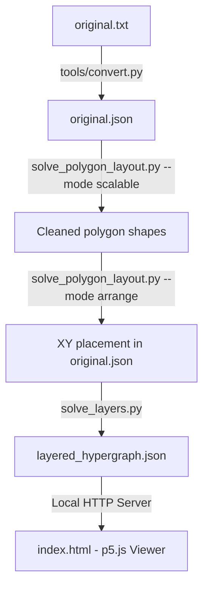

# Layered Hypergraph Drawing Visualizer

## フォルダ構成

ルートには solve で始まるPythonファイル、original.json、original.txt、
masuta.csv、layered_hypergraph.json、index.html、Markdownを配置する。
Git・Python環境・エディター設定・自動生成キャッシュは従来の場所に保持する。

| フォルダ | 内容 |
| --- | --- |
| polygon_layout/ | ポリゴン配置の補助PythonモジュールとC++カーネル |
| tools/ | データ変換、比較画像の作成ツール |
| tests/ | ソルバーとポリゴン処理のテスト |
| results/layouts/ | 過去のXY配置・実験候補JSON |
| results/layers/ | 過去のレイヤー割り当て、初期解、チェックポイント |
| results/reports/ | 計算・品質評価レポート |
| results/previews/ | 比較画像、SVG、全ポリゴン確認HTML |
| backups/ | 入力の退避データ、以前のバックアップ、移動記録 |

移動したファイルの一覧と移動直後のハッシュは
[移動記録](backups/reorganization_20261113.json)に記録している。
ソースとMarkdownは、その後にimport・参照先を更新している。
既存ソルバーの既定出力先は従来どおりなので、新しい結果を分類して保存する場合は
出力ファイル名や --report / --preview / --initial-output / --checkpoint を指定する。

以下のコマンドはプロジェクトのルートから実行する。

~~~powershell
python tools/convert.py
python tools/plot_polygon_comparison.py backups/original_before_polygon_layout.json original.json results/previews/polygon_layout_comparison.png
python -B -m unittest discover -s tests -v
~~~

This project is a complete pipeline for assigning layers (Z-levels) to hyperedges in a hypergraph to avoid overlapping polygons, and rendering them in an interactive 2.5D 3D space.

The system consists of four main components:
1. **Data Converter (`tools/convert.py`)**: Converts raw hypergraph text data (`original.txt`) to structured JSON format (`original.json`).
2. **Polygon Optimizer (`solve_polygon_layout.py`)**: Shapes polygons, then uses `--mode arrange` to reduce XY overlaps while preserving the cleaned shapes and shared vertices.
3. **Layer Assignment Solver (`solve_layers.py`)**: Computes shared vertex weights and overlap constraints, determines layout ordering using Spectral Layout (Fiedler vector), and optimizes layer coordinates using a strictly convex QP formulation solved via SciPy.
4. **Interactive 2.5D Viewer (`index.html`)**: An interactive 3D WebGL-based visualizer built using p5.js, featuring translucent polygons, node spheres, vertical connector lines, search filtering, and hover tooltips.

---

## Architecture Diagram



---

## Installation & Setup

1. **Set up a Python Virtual Environment**:
   ```bash
   # Create a localized virtual environment
   python3 -m venv .venv

   # Activate the virtual environment
   source .venv/bin/activate
   ```

2. **Install Required Python Dependencies**:
   ```bash
   pip install numpy scipy shapely
   ```

---

## Detailed Usage Pipeline

### Step 1: Convert Text Data to JSON
Parse raw data from `original.txt` (containing node locations and hyperedge definitions) into structured JSON format `original.json`:
```bash
python tools/convert.py
```

### Step 1b: Optimize the polygon coordinates

Run the polygon optimizer before assigning heights:

For a new input, the sequence is **shape → XY arrangement → layer assignment**.
If `original.json` already contains the selected shaped/arranged coordinates,
start directly with `solve_layers_dummy.py`. Running `--mode scalable` again
starts a fresh Hu layout by default; it does not simply continue the saved layout.

```powershell
.\.venv\Scripts\python.exe solve_polygon_layout.py
```

With no arguments, both input and output are `original.json`. The input is backed
up as `backups/original_before_polygon_layout.json` (or a unique additional backup)
before replacement. IDs, all memberships including repeated IDs, labels, colors,
and other metadata are preserved. Each node has one shared XY coordinate.

Same-file `paper`/`scalable` runs check every polygon before replacement.
By default, **not one face may worsen in regularity ratio** (`--shape-tolerance 0`).
The earlier 10% default has been removed. Invalid/degenerate faces may be repaired,
but that does not exempt the other valid faces from individual checks.
A rejected result leaves the original bytes untouched. Its report and previews
describe the rejected candidate, with `wrote_layout: false`. Explicit separate
output files still save experimental candidates, including rejected tradeoffs.
Each report has `all_face_judgment`, including every face's quality failures,
before/after metrics, regression result, worst value, and counts. Absolute quality
and non-regression are distinct: `all_faces_pass_quality: false` means the shape
task is still incomplete even if a safe update was permitted.

The new implementation uses Qu et al.'s unnormalized PR/PA/PS/PI energies,
convex-hull-centroid starrization, L-BFGS, and exhaustive within-face coordinate
pair swaps. `--dual` additionally optimizes the dual view and DD energy. Hu
initialization uses Graphviz `sfdp`; the former approximate force initializer
and cardinality-normalized objective have been removed.

The default `--mode scalable` uses a bipartite Hu initialization, records a paper
objective baseline, and then adds global regular-polygon consensus, a regular
polygon fitting term, a convex-hull area deficit penalty and short-range vertex
repulsion. These extensions help high-cardinality faces retain their outlines.
They are distinct from the topology-changing simplifiers in the 2023/2024 papers.
See [the Japanese implementation and source audit](polygon_layout_reproduction.md)
for equations, settings, reproduction scope, and geometric limitations.

Requirements: Python with `numpy scipy shapely`, Graphviz including `sfdp`, and a
C++17-capable `g++`. The Python entry point automatically compiles
`polygon_layout/polygon_kernel.cpp` into a cached shared library in `.polygon_cache/` on first
use. **Run the Python script, not the C++ file as an executable.** On this Windows
installation Graphviz is also discovered in `Program Files (x86)/Graphviz/bin`.
Use `--sfdp PATH` for another installation.

To save a candidate separately, or run only the paper coordinate objective:

```powershell
.\.venv\Scripts\python.exe solve_polygon_layout.py original.json candidate.json --report candidate_report.json --preview candidate.svg
.\.venv\Scripts\python.exe solve_polygon_layout.py original.json paper.json --mode paper --initialization hu-clique --report paper_report.json --preview paper.svg
.\.venv\Scripts\python.exe -m unittest tests.test_solve_polygon_layout -v
```

Available initializations: `hu-clique`, `hu-bipartite`, `input`, `circular`, and
`random`. `--initial-layout FILE --initialization input` warm-starts from another
JSON with identical IDs and memberships. `--iterations 600 --max-cycles 6` are the
default budgets per phase. `--fit-weight 1 --convexity-weight 10
--collision-weight 0.05` control only the scalable extension. Budget exhaustion
is reported separately from convergence; regular polygons are not guaranteed
for arbitrary shared memberships.

`results/reports/polygon_layout_report.json` records whole-graph and per-face regularity ratios
(1 is ideal), concavity, hull deficits, actual polygon overlap counts, stages,
weights and initializer versions. `results/previews/polygon_layout_comparison.svg` compares the
largest faces and representative smaller ones, retaining all member vertices.
Inspect both shape and overlap metrics: improving shape can increase overlaps.
The SVG is a selection; `polygon_layout_all_faces.html` shows **every polygon**,
including small ones, with search and filters for failures and regressions.
An optional PNG including the full graph can be rendered with matplotlib:

```powershell
.\.venv\Scripts\python.exe tools/plot_polygon_comparison.py backups/original_before_polygon_layout.json original.json results/previews/polygon_layout_comparison.png
```

The source remains the existing JSON; this command does not reimport
`masuta.csv` or repair earlier parsing changes. Regenerate layer assignments
after changing XY, since their overlap constraints refer to the previous
geometry. Running `tools/convert.py` again restores the text export's coordinates.
The earlier `results/layouts/original_polygon_candidate*.json` files are historical experiments.

To judge all current polygons without optimizing or changing any coordinates:

```powershell
.\.venv\Scripts\python.exe solve_polygon_layout.py original.json --audit-only --audit-reference backups/original_before_polygon_layout.json
```

This writes `results/reports/polygon_quality_report.json` and `results/previews/polygon_quality_all_faces.html`.
Omit `--audit-reference` to review absolute quality of the current layout alone.
Review limits are the same for every polygon: regularity ratio <=1.20, hull area
deficit <=0.02, and side-length CV <=0.25, plus valid nondegenerate geometry.
These are repository review settings, not thresholds from the paper. Adjust
them with `--quality-regularity-max`, `--quality-hull-deficit-max` and
`--quality-side-cv-max`. Unary, binary and empty edges are all recorded separately;
they are not counted as area polygons that passed the shape tests.
See [the automatic-layout research](polygon_auto_layout_research.md) for the
papers' algorithms, differences from this implementation, and the current audit.

### Step 1c: Reduce overlaps after shaping (XY placement)

Keep the cleaned polygon shapes as the reference, then adjust the shared XY
coordinates before assigning any layers:

```powershell
.\.venv\Scripts\python.exe solve_polygon_layout.py --mode arrange --iterations 300 --max-cycles 3
```

This updates `original.json` only if the actual intersections improve within the
shape limits. Its exact previous bytes are saved in
`backups/original_before_polygon_arrangement.json` (or a unique additional backup).
To retain a separate candidate, use:

```powershell
.\.venv\Scripts\python.exe solve_polygon_layout.py original.json results/layouts/original_polygon_arranged.json --mode arrange --iterations 300 --max-cycles 3
.\.venv\Scripts\python.exe tools/plot_polygon_comparison.py backups/original_before_polygon_arrangement.json original.json results/previews/polygon_arrangement_comparison.png
.\.venv\Scripts\python.exe -B -m unittest tests.test_polygon_arrange tests.test_solve_polygon_layout tests.test_solve_layers_dummy -v
```

`arrange` starts from the input coordinates, preserves every boundary's member
order, and optimizes one XY pair per original node. It penalizes deformation
after best rigid alignment with the input shape, searches using directional
polygon separation, and checks actual Shapely intersection areas before
accepting a candidate. The report and SVG use the separate names
`results/reports/polygon_arrangement_report.json` and `results/previews/polygon_arrangement_comparison.svg`.
Graphviz is not needed for this mode; the native kernel still requires `g++`.

Default shape limits are: no individual regularity ratio may worsen,
mean regularity at most 2% worse, each area within 80–120% of its input area,
and each hull deficit at most 0.02 higher. `--shape-tolerance 0.05` explicitly
allows up to 5% individual regularity regression. These limits refer to the input of each
invocation, so repeatedly running on updated output can accumulate changes.
Reuse the same saved reference when comparing parameter settings.
The placement report also records every polygon's judgment, and
`polygon_arrangement_all_faces.html` shows all faces rather than a sample.

The direct separation targets are polygon pairs sharing at most two vertices.
Shared IDs are retained, and eliminating all overlaps is not guaranteed.
Unary and binary edges retain their memberships but have no polygon-area
overlap objective. This post-shaping stage is a repository extension inspired
by Polygon Separation, rather than a reproduction of the papers' entire
simplification pipeline. See [the implementation details](polygon_arrangement.md).
Running the script without `--mode arrange` still runs the shape optimizer.

### Step 2: Run the Layer Assignment Optimization
Perform the 2-phase layer assignment algorithm to determine optimal Z-levels for each hyperedge:
```bash
python solve_layers.py
```
This script runs the following optimization flow:
- **Constraint Extraction**: Uses `shapely` to construct 2D polygons by connecting nodes in their exact defined order for each hyperedge and identify the overlap set $C$ (where intersection area $> 10^{-9}$).
- **Phase 1: Spectral Layout**: Builds the graph Laplacian of shared vertex weights $W$ (regularized by $\epsilon = 10^{-5}$ to ensure connectivity). Computes the Fiedler vector (eigenvector of the second-smallest eigenvalue) to determine a strict stable sorted order.
- **Phase 2: Convex QP**: Sets up a strictly convex QP on a reduced system of $N-1$ variables by eliminating the anchor constraint ($x_0 = 0$). The objective is scaled for numerical stability and solved via `scipy.optimize.minimize(method='SLSQP')` to ensure $|x_i - x_j| \ge 1.0$ for all overlapping pairs $(i, j) \in C$.
- Output is stored in `layered_hypergraph.json`.

### Step 3: Run the Visualizer
Start a local HTTP web server to serve the viewer files:
```bash
python -m http.server 8080 --bind 127.0.0.1
```
Open your browser and navigate to:
```
http://127.0.0.1:8080/index.html
```

---

## Viewer Features & Controls

The p5.js-based 2.5D visualizer runs in WebGL mode and provides several controls for exploration:

*   **Interactive 3D Viewport**: Left-click and drag to rotate the scene, right-click and drag to pan, and scroll to zoom in/out.
*   **Vertical & Horizontal Scale**: Slide controls allow adjusting the horizontal spacing (XY scale) and the vertical spacing between layers (Z scale).
*   **Translucent Polygons**: Hyperedges are drawn as filled, color-coded translucent polygons representing their node-order outlines.
*   **Vertical Connector Lines**: Nodes shared by multiple hyperedges are linked across layers using vertical pillars.
*   **Auto-Rotation**: Toggles a slow, continuous rotation of the 3D canvas for a dynamic visualization.
*   **Search Filter**: Input terms to filter and highlight matching nodes/edges (e.g. search for `TTF-1` to highlight that specific hyperedge).
*   **Details on Hover**: Projected 3D-to-2D coordinates dynamically trace the mouse position. Hovering over nodes or edges reveals a floating details card.
