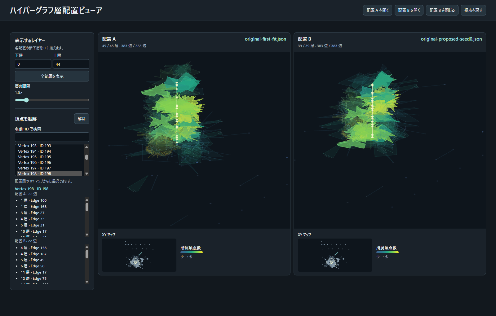
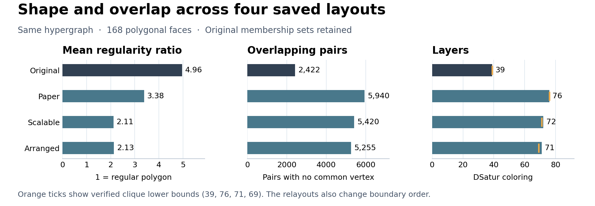
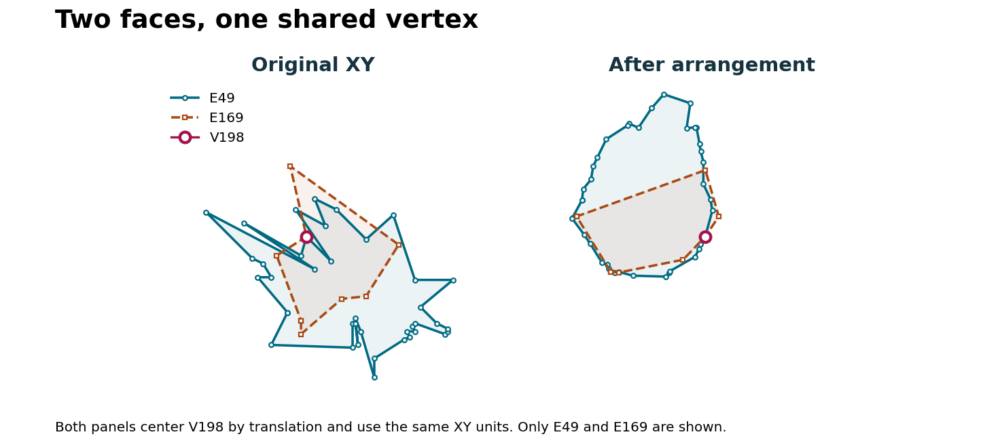
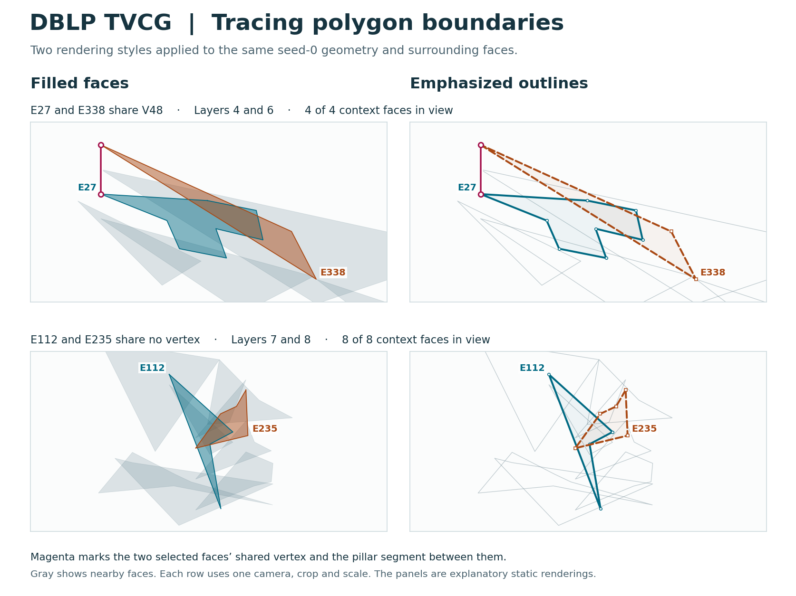
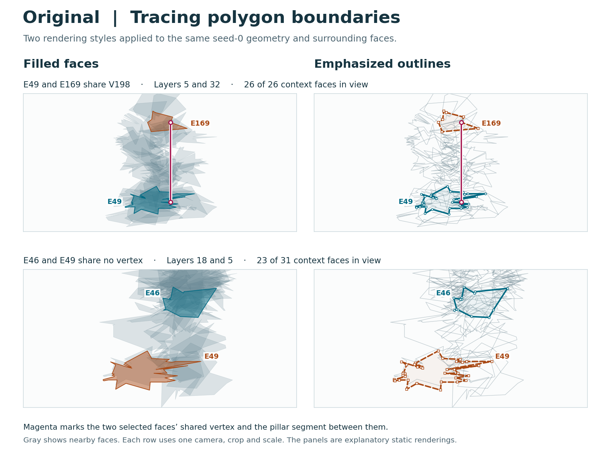

# 一枚の面を輪郭に沿って追えるか

2026年11月28日改訂。PacificVis 2027 VisNotes に向けて、共有頂点を結ぶ垂直柱から、どのハイパーエッジに属するかを読める条件を調べる。公開 DBLP では一つの面が論文、一つの頂点が著者に対応する。主図の問いは「指定した二つの論文は著者を共有するか。図のどこからそう判断できるか」とする。独自データ `original.json` は全627頂点・383辺を用いる内部の高密度事例、公開 DBLP TVCG は全1,008頂点・429辺を用いる論文用事例とする。 [esa の原計画 §1・§2・§4](https://vdslab.esa.io/posts/9193)・[読み取り課題の改訂](https://vdslab.esa.io/posts/9274)・[全入力の検証](https://vdslab.esa.io/posts/9278)

## 現状を示す二つの観察

**図1　全体で見失うのは柱の先にある面。** 同期ビューアの左は入力順 first-fit、右は提案法の seed 0。頂点198の白い柱と、所属する22辺が集まる19層の接点は両方で見える。中央の黄緑色の塗りが重なり、接点から一枚の面の外周をたどりにくい。柱のスパンは37から33層分に縮んだが、同じ35°の投影でその柱と重なる非所属面は37から40枚に増えた。これは画面上の重なり件数である。全383辺が読み込まれ、空辺1件には描画図形がない。図は既報の実画面を再掲した。 [計測条件・元の画像](https://vdslab.esa.io/posts/9278)

**図2a　輪郭の整い方と、周囲の面との重なり。** 168面の平均正多角形比（1が正多角形）は4.964から2.128に近づいた。 同じ所属関係を持つ `original.json` 系列で、共有頂点のない面どうしの XY の重なりは、未整形の2,422組から整形・配置調整後の5,255組に増えた。DSatur が使った層は39から71に増えた。39は下界と一致する。整形後の下界は69で、71は得られた彩色の上界である。保存版では383辺中163辺で境界頂点の記録順も変わっているため、結果には座標と頂点順の両方が寄与しうる。 [保存済みの XY 比較](../results/experiments/visnotes_remaining_01/exp05/summary.json)

**図2b　同じ二面は、どのような形になるか。** 青の辺49では左の尖った突起が右で減り、橙の辺169の一部は青い輪郭のすぐ近くを通る。二面に共通するIDは両図とも赤丸の198だけである。共有点を平行移動で揃え、軸方向と倍率を固定した。二面を抜き出した上面図であり、平面全体の混雑度は図2aで確認する。

## 描き方の比較を先に行う

面の位置を動かさず、塗り・境界線・頂点記号で何が読めるかを比べる。まず一つの配置の同じ二面を、塗り主体と輪郭主体で並べる。候補は色と線種で区別し、面IDは対応する境界の近くに置く。周囲の面も両方に同じ範囲・同じ抽出規則で残す。解説時は共有頂点の層間を垂直な線で結び、所属する面に接点を打つ。同じ柱の途中を横切る非所属面に接点を付けない。所属が同じ高さに複数ある場合は、操作時に面IDと件数を展開できる設計を試す。

**図3　公開 DBLP で何を見分けるか。** 論文27と338は著者48を共有する。論文112と235に共通著者はない。上の組では接点から両方の面の境界に移れるか、下の組では近くの輪郭を同じ面と取り違えないかを見る。上段では灰色の4面、下段では8面が画角内に入る。上段では著者48を含まない面が候補の輪郭を線分として覆う例がないため、各輪郭に最も近い非所属面も含めた。左右では背景、対象、柱の順に同じ投影を上描きした。線種・頂点記号・塗りをまとめて変えた静止図で、実ビューアの奥行き処理や人の正答率は評価していない。

**図4　独自データで同じ設計を試す。** 辺49と169は頂点198を共有し、辺46と49には共有頂点がない。元の XY で二面の重なり内部に取った代表点を覆う第三の面はそれぞれ24枚と29枚。それぞれ投影上の非所属面を2枚加え、背景26枚中26枚、31枚中23枚が画角内に入る。青と橙は各行の二候補を示す。右下のように背景と候補の線が密な場所では、輪郭を増やすだけでは境界を追いにくい。既出の両組をそのまま用いたため、この図で出題する問題と人の評価に使う未知の問題は分ける。 [ペア選定と所属の真値](https://vdslab.esa.io/posts/9278)

## 原計画の三つの貢献に対する変更

| 原計画 | 今回追加する比較 | 採否に使う証拠 |
| --- | --- | --- |
| C1　層割り当て | 入力順 first-fit と提案法に同じ描画を適用する。根付き木との定量比較も維持する。 | 同じ入力・予算での使用層数、柱総長、ハブ別のスパン、制約違反。形状や描画の効果を層割り当ての成績に含めない。 |
| C2　XY 整形と層数 | 元の XY、既存の正多角形化・配置調整、細長い面や鋭い突起だけを抑える候補を比べる。共有頂点は全所属面で同じ XY を持ち、所属IDと境界の順序を保つ。 | 頂点数帯ごとの最小内角・正多角形比・面積変化、自己交差・退化件数、共有0／1／2／3以上の重なり組数、同じ彩色法の層数と柱総長。局所の形が改善しても非所属面との重なりや層数が増えた条件を併記する。 |
| C3　遮蔽と面の追跡 | 塗り主体と輪郭主体を同じ XY・層・視点で比較。次に採用した描画で上面2D、層別平面図、first-fit 2.5D、提案2.5Dを比較する。 | 所属の有無とその根拠の位置を別々に採点し、誤って共有と答えた割合・見落とした割合、位置誤差、正答時の時間、不明・時間切れを報告する。 |

形状の新候補は先に高次数面の面積増加を点検し、同じ頂点を別々に移動する操作や、非所属頂点が面の内部に入り込む例を記録する。座標だけを変えた条件と境界順だけを変えた条件も比較し、すべての条件で有効な共通面数・除外数を明示する。既存の対照実験を出発点とする。 [座標と順序を切り分けた既報](https://vdslab.esa.io/posts/9257)自己交差・退化を新たに生じた候補は棄却する。単項・二項辺は全体の件数と読み取りの文脈に残し、面の内角・面積の集計は三つ以上の異なる頂点を持つ有効面に限る。

## 実施順と投稿の判断

| 期限 | 誰が、何を確かめるか |
| --- | --- |
| 11月30日 | 設計担当が候補ペアを共有の有無、頂点次数、周囲の混雑度で層別する。結果を見る前に例の選び方、負例の見かけの交差、正答座標、表示寸法、位置誤差の許容値と制限時間を固定する。 |
| 12月7日 | 実装担当が同じカメラ・倍率・面集合・層間隔で両描画を切り替えられる試作を用意する。査読担当は輪郭の白黒印刷、線種の判別、候補ラベルの遮蔽を論文幅で確認する。主視点は方位45°・仰角35°とし、75°と上面でも結論が逆転する例を残す。 |
| 12月8〜13日 | まず研究者本人が手元で課題を試す。回答前は一覧、正解だけを示す柱・接点・ラベル、ホバーの答えを隠す。ヒントの量と操作範囲を揃え、手法名を伏せる。共有あり・なしを混ぜ、同じ人に同じペアを繰り返さない。正例は共有位置を答える。負例では表示中に重なりが見えればその位置を答え、図4下段のように二面が離れていれば「この視点では交差なし」を選ぶ。後者は位置誤差の母数から除き、件数を示す。近い点を選ぶだけで正解できる出題も別途検査する。人の読み取りが速く、正確になったと主張するには、参加者による評価を未提示例で実施し、条件ごとの件数と不確かさを報告する。 |
| **12月14日** | 監督担当が二条件を判定する。①公開 DBLP の論文幅の主図で、上面2D・従来 first-fit の各々に対して、何が追いやすくなったかを課題の位置で示せること。②複数入力で配置の定量的な優位を示し、近傍アブレーション・XY整形を含む結果を保存データから独立検証できること。片方でも欠ければ原計画どおり VisNotes 投稿を見送る。輪郭表示で両方式が同程度に読める場合は描画の寄与として報告する。 |

今回の到達点は、既存の測定値と実画面を照合し、比較する局所図と判定手順を作ったところまでである。新しい XY 整形法、輪郭表示の実ビューアへの組み込み、人を対象とした読み取り成績、12月14日の投稿判定は今後の作業となる。

## 図の再現

実験IDは `visnotes_polygon_plan_01`。図1は既報の実画面を再掲した。図2a・2bは保存済み4条件のXY入力、図3・4は両データの提案配置 seed 0 を使った。局所図の予算は各入力120秒、合計300秒。4組×2描画を出力して終了し、新たな層探索は0回。候補面と背景面のID、画角、接点座標、入力ハッシュ、実行時間は[図の記録](../results/experiments/visnotes_polygon_plan_01/figure-data.json)にある。DBLP の数値のみの形状・所属・層も同梱した。 [DBLP入力の提供元 HGPolyVis](https://github.com/peterdanieloliver/HGPolyVis/tree/ba8868b1b002be5c32fb1e83548778fd7feed186/Data/PaperAuthor_DBLP) [局所図のコード](../experiments/visnotes_polygon_plan_01/run_experiment.py)・[形状図のコード](../experiments/visnotes_polygon_plan_01/plot_xy.py)

リポジトリ直下で Python、NumPy、Matplotlib、Shapely を使って次を実行する。出力先は未使用の名前を指定する。

~~~powershell
$figDir = Join-Path ([IO.Path]::GetTempPath()) ("visnotes-polygons-" + [guid]::NewGuid())
python -B experiments/visnotes_polygon_plan_01/run_experiment.py --output $figDir
python -B experiments/visnotes_polygon_plan_01/plot_xy.py --output "$figDir/xy-tradeoff.png" --example-output "$figDir/xy-pair.png"
~~~
