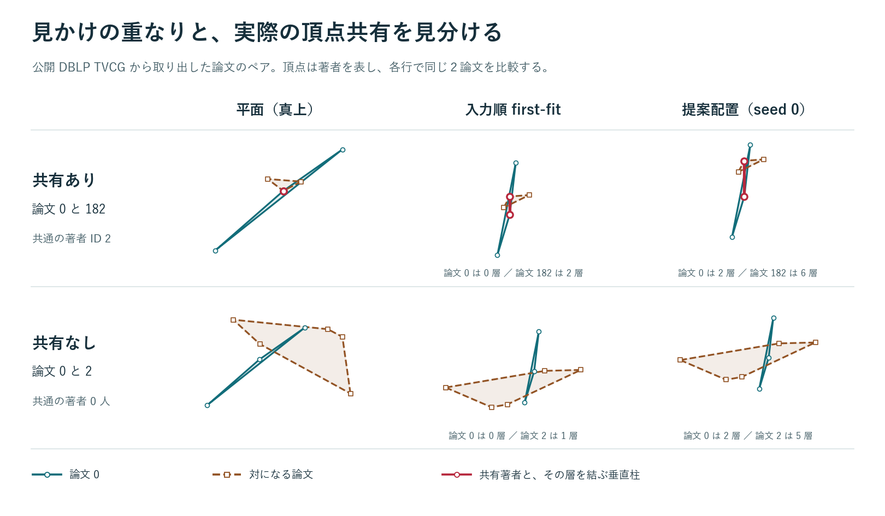

# VisNotes の図と評価をどう改めるか

2026年11月27日。**現行の Fig. 1 では、研究計画が12月14日に求める「平面表示と従来の多層表示の双方に対する視覚的な利点」を示せていない。** 論文の問いを「同じ著者を含む論文と、画面上で重なって見えるだけの論文を、その位置から見分けられるか」に絞る。全データを保持し、全体から局所へ移ったとき、どの面とどの頂点の対応を追えるのかを示す。柱の総長を縮めた成果は、そのまま配置の評価として報告できる。 [esa の原計画 §1・§2・§4](https://vdslab.esa.io/posts/9193)・[既存の実験報告とビューア画像](https://vdslab.esa.io/posts/9257)

## 今の図で何が読めるか

**図1　現行の投稿候補。** 赤い柱は同じ著者 ID 48 を追えている。一方、描いた20辺はすべてこの著者を含む。読者は「どの論文がこの著者を含み、どれが近くを通るだけか」をこの図で試せない。DBLP TVCG 全体は1,008頂点・429辺。seed 0 では入力順 first-fit と提案法でともに10層、全頂点の柱総長は704から442に縮むが、この著者の柱は0〜4層から1〜7層へ伸びる。1本の柱の長さと全体の集計は別々に図示する。

**図2　同じ入力・視点・倍率でのビューア比較。** 選択すると共有頂点を各層の同じ XY 位置で結ぶ垂直柱が現れる。現画面では着目点が両ペインの右端に寄り、所属面の一部が枠外に出る。左欄の所属一覧と面の強調は著者の作品を探す操作には役立つ。所属を当てる課題にこの状態を使うと、図形を追う前に答えを読める。原文が診断した旧ビューアのピンク一色の問題と、現在の視野・課題の問題は発生箇所が異なる。

**図3　配置を支える結果と、見やすさを断定できない理由。** 提案法5 seedの中央値との比較では、DBLP TVCG の柱総長は704→437、同じ画素に複数面が投影される画素数は7,826→7,890。seed 0 の投影面の交差対も、方位45°・仰角35°では1,061→1,088、仰角75°では1,221→1,173と向きが逆転する。画素数・交差対・人の誤答率は異なる量である。全体の `original.json` は627頂点・383辺で、同じ入力順 first-fit と提案の seed 0 は45→39層、柱総長9,492→5,891、頂点198のスパン37→33。10層は公開 DBLP の値である。独自データは既存の状態で内部検証に使い、論文の主図は公開 DBLP で作る。 [公開比較の条件と結果](https://vdslab.esa.io/posts/9257)

## 新しい図で何を見せるか

**図4　同じ公開入力で描き直した解説図案。** 実線・丸は論文0、破線・四角は相手の論文を示す。上段では著者2を示す赤い輪を、異なる高さでも同じ柱の両端として追える。下段では境界が交差して見える場所に共通の著者はいない。上段の2論文の層差は従来法で2、提案法で4。共有の有無を説明できても、この例から提案法の優位までは言えない。

図4は入力順で3〜6頂点の有効面を組にし、XYの交差面積が小さい方の面積の10%以上となるものから、共有頂点が1個・0個の最初の組をそれぞれ使用した。元の座標・所属・全体で求めた層を保存し、各行の3図は同倍率、2つの2.5D図は方位45°・仰角35°の共通窓、層間隔は全入力のXY最大幅の1/100とした。各行は2辺の抜粋である。選定は提案の改善量を参照しない。 [公開入力の出典](https://github.com/peterdanieloliver/HGPolyVis/tree/ba8868b1b002be5c32fb1e83548778fd7feed186/Data/PaperAuthor_DBLP)

**投稿用の Fig. 1。** 左上の小さな全体図に抜き出した範囲を描き、主図の上に「この2論文は著者を共有するか」と書く。その下に上面2D、Qu §6 に基づく入力順 first-fit、提案法を並べる。候補のIDを境界に直接付け、線種と頂点記号を3条件で統一する。2.5Dでは同じ向き・層間隔・世界座標の倍率を使い、両配置の全候補が収まる共通の表示範囲を取る。低次数辺は従来どおり点・リボンで識別できるようにする。図の下に元の所属から得た答え、見分ける位置、表示辺数／全辺数を示す。正答を示す解説図と、回答前に見せる図を保存時から区別する。 [Qu et al. (2017) §6](https://web.engr.oregonstate.edu/~zhange/images/Nary.pdf)

**操作画面。** 全体図で対象を選ぶと、左右が一緒に対象中央へ移動する。選択した共有頂点の垂直柱、所属層の接点、近くの非所属面を見比べ、同一範囲のZスライスを両側で切り替えられるようにする。柱の途中を通過した面と実際の所属点を描き分ける。同じ層に所属面が複数あるときは接点に件数を付け、展開して面IDを確認できるようにする。ズームを戻すと全体での位置が分かる。全体の層数と柱総長、選択頂点のスパンを別々に表示する。

## 敵対的検討で変えた点

設計担当が案を提示し、査読担当が反例を出し、その配下の検証担当が保存済みの刺激と正答を独立に照合した。監督担当が実図、公開入力、2つの配置、課題の全18図を再確認した。

| 最初の案 | 査読側の反例 | 改訂後の判断 |
| --- | --- | --- |
| 所属面を強調して選択頂点を拡大すれば、追いやすさを示せる | 図1の20辺はすべて正答で、ビューアには所属一覧もある | 解説・探索では柱と所属を明示する。試験では答えを示す柱端、一覧、ホバーを隠す。共有あり・なしの双方を入れる。 |
| 柱総長が改善した例を代表図にする | ID 48 は柱が伸び、カメラの仰角だけで投影交差の増減も逆転する | 入力の頂点次数とXY混雑度で対象を層別し、seed・ID・視点を先に固定する。改善・同値・悪化の件数とID 48を残す。 |
| 今の4択パイロットで高密度の利点まで評価する | 誤答面の境界頂点と黄色ガイドの距離を8 SVG単位以上とする選別がある。各図でガイドに最も近い頂点を持つ面を選ぶだけで6問×3条件の18/18が正解。次点の最小距離は9.856。対象6頂点の全所属数は2、2、2、4、2、2で、図1の20所属とは難度が異なる | 現行課題は基礎的な所属判定と操作確認に使う。新課題には近接した非所属面と見かけの交差を含め、距離・次数別の成績を出す。18/18は規則で照合した数で、人の成績は未計測。 |
| 関係を照合できれば立体表示が有利といえる | 所属の有無だけなら一覧で即答できる。ラベルを付けた層別平面図でも位置を追える可能性がある | 新課題では共有の有無に加え、根拠の位置を指す。層別平面図を低コストの対照に加え、2.5Dを使う利点がどの課題に残るか調べる。 |

## 実施順と判定

| 期限 | 成果物・担当 | 通過条件 |
| --- | --- | --- |
| 11月30日 | 設計担当が対象ペア、抽出規則、ID、カメラ、正答、除外理由を固定。公開DBLPを主事例、`original.json` 全体を内部の密集例とする | 元の所属から真偽を復元できる。真偽・次数・XY混雑度に偏りがある区分は件数を示す。正例は共有IDと位置、負例は指定した投影での見かけの交差位置を採点できる。 |
| 12月7日 | 実装担当が同期する局所図・層別平面図・課題画面を新規ファイルに作成。査読担当が表示を比較 | 同じ配置で旧描画と新描画を比べ、同じ新描画で first-fit と提案配置を比べる。上面2Dも同じXY・候補を使用。全候補が枠内に入り、画面サイズ・色以外の印・所属の漏れを確認する。共通の補助表示は各手法で同じ情報量にする。 |
| 12月8〜13日 | 著者が手元で課題と論文幅のPDFを確認し、監督担当が図・正答・回答ログを照合 | 手法名と正解を隠して回答できること、誤答・不明・タイムアウト・位置の誤差が別に残ることを確認する。図1枚とキャプションで問い、対象、差、悪化例が読めるか記録する。 |
| **12月14日** | 監督担当が原計画 §4.2 の二条件を判定 | **両方が必要。** ①公開の主要図で、事前に決めた課題に対する2D・first-fitそれぞれとの違いと利点を指し示せる。②複数入力の手法比較・アブレーション・XY–Zの数値を保存配置に対して独立に確認できる。どちらかを説明できなければ VisNotes 投稿を見送り、図と主張を再検討する。 |

**比較の読み方。** 主視点は方位45°・仰角35°。仰角75°と真上を含む保存済み視点で結論の反転を記録する。局所ビューでの改善を全体に外挿しない。新課題では、真偽の正答率、正答時の位置誤差・応答時間、不明・時間切れの件数を条件別に残す。位置の許容誤差、対象ペア、表示寸法、割付を採点前に固定する。正式に人を対象とする場合は、同じ人が同じペアの答えを覚えないよう項目を割り付け、参加者内の差と不確かさを報告する。現時点は参加者0人、動作確認1件。まず著者が手元で確認する。速さ・正確さの優位を論文に書くには、その主張に対応する人のデータが要る。 [現行課題の生成・割り付け・採点](https://github.com/vdslab/theme2026-dan/blob/f724b97e26e1f3c35b9173041a460bda90eee3a8/experiments/visnotes_reading_study_01/README.md)

**原計画に対する変更範囲。** C1 は層割り当てと柱総長を主張し、根付き木は従来手法との比較に使う。C2 はXY整形で重なり・必要層数が増える条件を示す。原文の「15層程度／20層以上」は調査する仮説にとどめる。C3 を「どの共有関係を、どの条件なら追えるか」という検証可能な事例に変更する。簡易な層別平面図で同じ問いに十分答えられた場合はその結果を載せ、立体表示の適用範囲を狭める。6ページの本文で Fig. 1 に問いと答え、評価図に集計と反例を収める。補足動画は操作の記録に使う。投稿締切は2027年1月4日23:59 AoE。 [VisNotes 公式募集要項](https://pacificvis2027.github.io/contribute/short-papers/)・[図・補足資料に関する公式指針](https://pacificvis2027.github.io/contribute/paper-submission-guidelines/)

**再確認に使った資料。** 公開データでは `visnotes_public_validation_01` の `public-main/dblp` にある入力順 first-fit と提案 seed 0 の配置、および `public-fig1/projection-sensitivity.json` を使用した。内部入力は `visnotes_remaining_01/figures/case-study.md` を参照した。課題の照合には `visnotes_reading_study_01/pilot-final` の `study.json`・`key.json`・`score.json` を用いた。各図について、候補の各境界頂点からガイド線分（平面では点）への最短距離を求め、距離が最小の候補コードを正答キーと突き合わせた。 [公開比較のコード](https://github.com/vdslab/theme2026-dan/tree/f724b97e26e1f3c35b9173041a460bda90eee3a8/experiments/visnotes_public_validation_01)・[課題生成コード](https://github.com/vdslab/theme2026-dan/blob/f724b97e26e1f3c35b9173041a460bda90eee3a8/experiments/visnotes_reading_study_01/run_experiment.py)

2026年11月27日14:20（日本時間）にチーム内へ掲載。記事本文の4枚のキャプションを確認し、配信された4枚のPNGを元ファイルと照合した。 [図入りの esa 報告 #9274](https://vdslab.esa.io/posts/9274)
