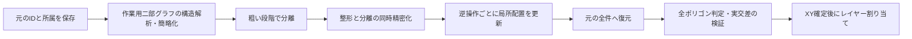

# ポリゴン自動配置の調査と現実装との差

調査日：2026-10-26。対象はレイヤーを割り当てる前の XY 配置。
論文に書かれた処理と、本リポジトリの追加処理・実装上の提案を区別する。

## 参照関係

| 研究 | 主な役割 | 原文 |
|---|---|---|
| Qu ら、2017 | ポリゴン表現・力学初期配置・対話編集 | [Interactive Design and Visualization of N-ary Relationships, §5](https://web.engr.oregonstate.edu/~zhange/images/Nary.pdf) |
| Qu ら、2021年プレプリント | 自動ポリゴン配置の基本手法 | [Automatic Polygon Layout for Primal-Dual Visualization of Hypergraphs, §3–4](https://arxiv.org/html/2108.00671v1#S3) |
| Oliver ら、2023年プレプリント | 簡略化と逆操作を用いる大規模配置 | [Scalable Hypergraph Visualization, §4.1–4.3](https://arxiv.org/html/2308.05043v1#S4) |
| Oliver ら、2024 | 構造に基づく簡略化と、その結果への配置 | [Structure-Aware Simplification for Hypergraph Visualization, §4–7](https://arxiv.org/html/2407.19621v1#S7) |

## 2017：完全グラフを使う段階の意味

§5 は clique を含むグラフに Hu の力学配置を適用してから、各関係の輪郭を
ポリゴンとして描く。その後の移動・回転・拡縮・頂点交換はユーザーによる編集。
clique にすれば必ず正多角形が完成する、という手法ではない。
共有頂点を動かすと隣接面も変形することを説明している。
大規模データで初期配置と手動編集に限界があることも §8 に述べている。
別に扱う §6 の3Dレイヤー配置は、今回の XY 自動配置とは別工程。
[原文 §5、§8](https://web.engr.oregonstate.edu/~zhange/images/Nary.pdf)

## 2021：形と配置を共通の変数で最適化する

変数は各ノードの XY を並べた `2|V|` 次元ベクトル。面ごとの独立座標ではない。
基本手順は clique 展開による Hu 初期配置 → starrization → 目的関数の最小化。
starrization は凸包の重心まわりに全メンバーを角度順に並べる操作で、
凸包上のメンバーだけを残す処理ではない。
[§3.3](https://arxiv.org/html/2108.00671v1#S3.SS3)

主目的関数は `0.30 PR + 0.16 PA + 0.36 PS + 0.18 PI`。

| 項 | 計算の役割 |
|---|---|
| PR | 全面について `P² − 4n tan(π/n) A` を合計し、正多角形へ近づける |
| PA | 境界辺の `Σ(l−1)²` により辺長を揃える |
| PS | 不要な重なりを分離するための距離・角度の不足を評価する |
| PI | 共有3頂点以上の場合、共通頂点の面と、親面を分割する境界弧の形を整える |

PS は交差面積そのものではなく、正多角形を仮定した近似。
共有0点は外接半径の和と重心距離、共有1点は共有点まわりの角度、
共有2点は重心距離、共有3点以上では直接の PS は0となる。
[§3.2、式(1)–(10)](https://arxiv.org/html/2108.00671v1#S3.SS2)

探索は L-BFGS の連続更新と、同一面内の2頂点の座標交換を交互に行う。
候補の評価ごとに starrization し、改善する交換だけを採用する。
二つのビューを使う場合は、ノードと対応する双対面の重心を近づける DD 項も加える。
つまり「形を固定した面を独立に並べ直す」処理ではなく、整形と分離を結合した探索。
合計エネルギーの改善を採用基準とする非凸最適化で、各面の個別改善や大域最適を保証しない。
[§3.3、§4](https://arxiv.org/html/2108.00671v1#S4)

PI の共通面は共通メンバーから構成する面であり、幾何的な交差領域の輪郭を
Shapely で求めて整形する処理とは異なる。

## 2023：複雑な配置を段階的にほどく

全ノードの座標を一度に調整するだけでは局所解に陥るため、多段階化する。
頂点・ハイパーエッジの除去と併合を作業用グラフに適用し、操作をスタックに記録する。
適用の合法性と優先順位をその都度更新する。優先度には次数・面の頂点数、
adjacency factor、betweenness centrality を用いる。
[§4.1–4.2](https://arxiv.org/html/2308.05043v1#S4.SS1)

最も簡略化した段階で、まず PS と DD だけを用いる分離を行い、
次に形状関連項も加える整形を行う。分離時の大きさは正多角形の理想半径でなく、
現在の各面の最大頂点間距離の半分を使う。整形時には元データの面の頂点数を使い、
あとで戻る要素のための空間を確保する。
[§4.3、式(3)](https://arxiv.org/html/2308.05043v1#S4.SS3)

その後、記録した操作を逆順に戻す。復元される頂点は対応する双対面の重心を利用して
初期化し、操作の footprint 内だけを再最適化する。外側の座標は固定するが、
外側の面も分離評価には含める。最終的には元の規模 `H0` へ戻す。
途中の局所調整を積み重ねることが、大きいグラフへの主な対応である。
[§4.3、Figure 9](https://arxiv.org/html/2308.05043v1#S4.SS3)

## 2024：不要な重なりと構造由来の重なりを区別する

指定論文は二部グラフを topological blocks、bridges、branches に分解し、
forbidden clusters などを調べて簡略化の場所を決める。
構造を保つ操作と構造を変える操作を使い分ける。
§7 の配置は、簡略化された二部グラフへの力学配置 → primal ノードへの座標対応 →
starrization → Qu らの primal-dual 自動配置。
[§4–7](https://arxiv.org/html/2407.19621v1#S7)

ここで表示される簡略化スケール `H'` は、元の全所属を持つ `H` と同一ではない。
その図の見やすさを、そのまま元の全件データの配置品質と同一視できない。
また、凸多角形での重なりの回避可能性と、すべてをほぼ正多角形にする条件は別である。
near-regular 制約が橋や枝にも重なりを生む可能性を、著者も今後の課題としている。
[§7–8](https://arxiv.org/html/2407.19621v1#S8)

## 現実装でできていることと不足

以下は論文の主張ではなく、今回のコード調査結果。

| 処理 | 現実装 | 判定 |
|---|---|---|
| 全ノードで共通する XY | `solve_polygon_layout.py` | 実装済み |
| PR / PA / PS / PI と交互探索 | `polygon_layout/polygon_kernel.cpp`、`polygon_layout/polygon_optimize.py` | 論文記述に基づく再実装。著者バイナリとの一致は未検証 |
| 双対と DD | `--dual` | 任意指定。通常の実行では無効 |
| 正多角形の当てはめ、凸包欠損、近距離反発 | `scalable` の追加項 | 本リポジトリの拡張 |
| 整形後の形状保持付き配置 | `polygon_layout/polygon_arrange.py` | 独自の後処理。2023年の分離段階と同じではない |
| 簡略化スタックと逆操作による多段階配置 | なし | 未実装 |
| 2024年の構造分解と forbidden clusters | なし | 未実装 |
| 全面の個別判定と全件レビュー | `polygon_layout/polygon_quality.py` | 今回追加 |

`scalable` というモード名でも、2023年論文の多段階手法を実装した意味ではない。
著者の [HGPolyVis公開README](https://github.com/peterdanieloliver/HGPolyVis) では
Windows実行物の配布を確認した。ソースと全パラメーターの一致を確認したとは扱わない。

入力の構成にも差がある。今回の既存 JSON は627ノード・383ハイパーエッジで、
最大の面は161頂点。一方、2023年論文 §5 の大きい paper-author 例は
1008ノード・429ハイパーエッジだが、最大の面は20頂点。
総要素数が小さくても、1面の頂点数や共有関係が同程度に容易とはいえない、というのが
本調査からの考察である。[比較対象の原文 §5](https://arxiv.org/html/2308.05043v1#S5)

## 今回のデータに対して採るべき構成

これは調査に基づく実装上の提案であり、今回すべてを実装したという記述ではない。



元のノードを恒久的に分割したり、`masuta.csv` の所属を書き換えたりせず、
作業用の各スケールと元IDの対応を保持する。最後には全所属の多重集合を照合する。
全件判定は平均だけでなく、未達の面・悪化した面・最悪値を記録する。
今回追加した判定はその検証部分であり、目的関数の面ごとの重み付けや
多段階配置の実装そのものを置き換えたわけではない。

## 全件判定の実行と今回の結果

```powershell
.\.venv\Scripts\python.exe solve_polygon_layout.py original.json --audit-only --audit-reference backups/original_before_polygon_layout.json
```

このコマンドは座標を変更せず、`results/reports/polygon_quality_report.json` と
`results/previews/polygon_quality_all_faces.html` を生成する。HTML は全168面の参照形状・現在形状を表示し、
名前・ID、品質未達、悪化で絞り込める。単項144件・二項70件・空1件も判定対象外として
全件記録し、面の形状を評価した件数に混ぜない。

現在の初期座標との比較では137面改善・31面悪化。確認用の既定基準は形状比 `<=1.20`、
凸包面積欠損率 `<=0.02`、辺長CV `<=0.25`、自己交差・退化なし。
この基準で達成7面・未達161面。これは本実装の確認用基準であり、論文が定めた合否値ではない。
`--quality-regularity-max`、`--quality-hull-deficit-max`、`--quality-side-cv-max` で変更できる。

同名ファイルへの形状更新は、既定では1面でも形状比が悪化すれば不採用。
`--shape-tolerance` は今回 `0.10` から `0.0` に変更した。
品質基準を全件満たすことと、入力から悪化しないことは別の記録であり、
`all_faces_pass_quality` が false の結果を「全体の整形完了」とは扱わない。
明示的な別名出力は実験候補として保存でき、その候補についても全件判定する。
