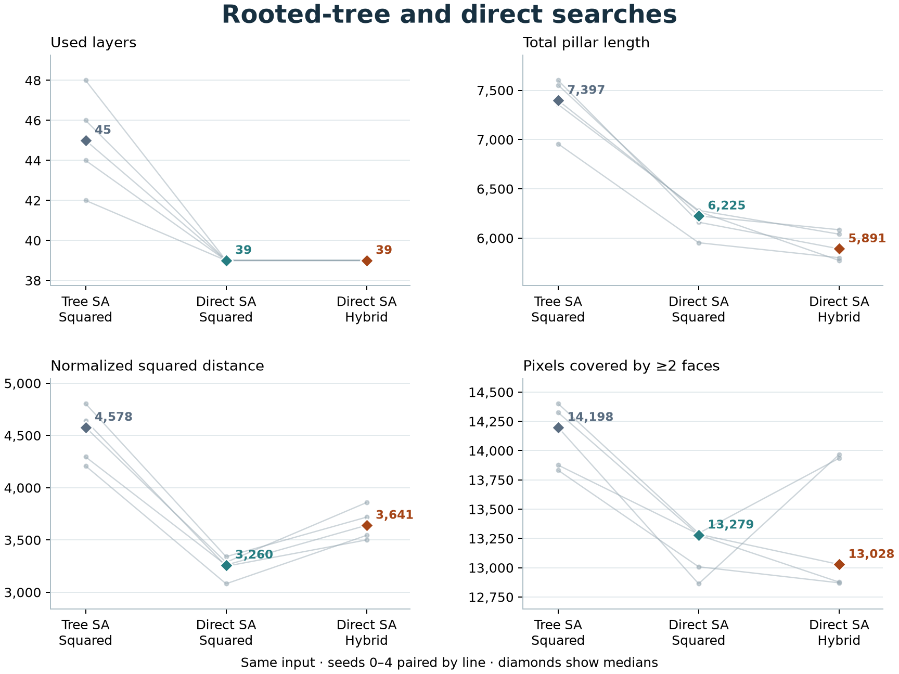
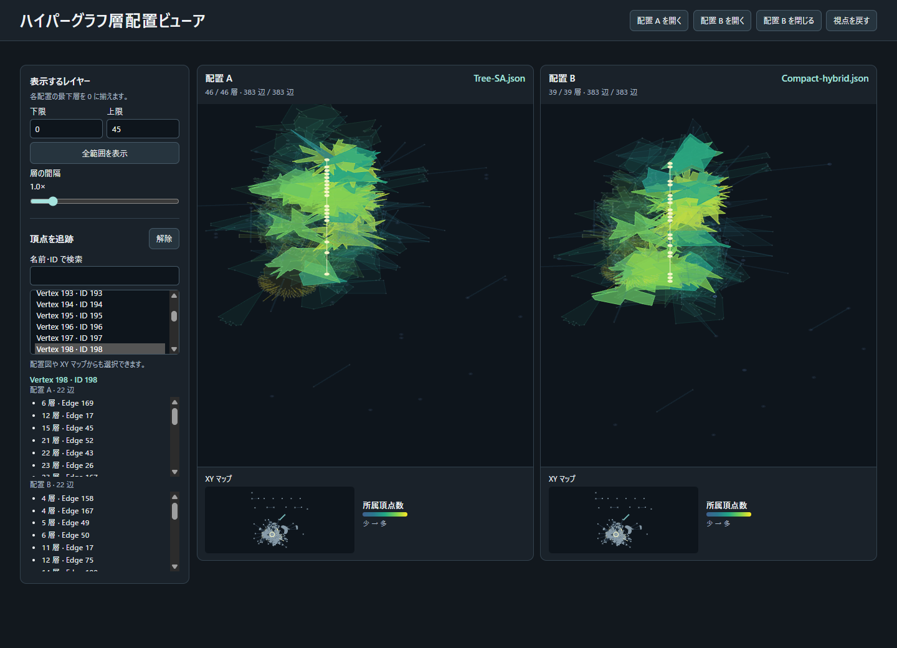
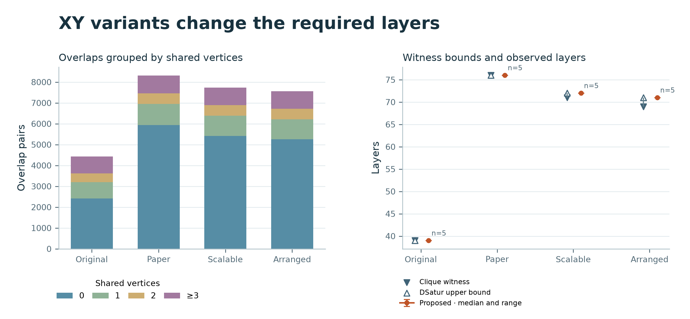

## 追試 visnotes_tree_comparison_01 — 根付き木と直接探索の比較

根付き木を比較の基準として、探索方法を変えたときの効果と、目的関数を変えたときの効果を確かめた。同じ二乗距離を最小化する条件でも、直接探索は5 seedすべてで根付き木より二乗距離が小さく、使用層数の中央値は45から39に減った。複合目的に切り替えると、さらに柱総長と投影の多重被覆画素数の中央値が下がった。

### 条件と検証

`original.json` の頂点・所属・XY・頂点順序・重なり判定を固定した。`.venv` の Python 3.11.5、単一スレッドで同じ seed 0〜4 の3条件を逐次実行した。各ケースの内部時間上限は25秒、試行上限は20,000。保存まで含むプロセスの上限は45秒、実験全体の上限は480秒。正則化は `1e-5`。前回の共通35秒枠で根付き木の最終保存が間に合わなかったため、今回は内部上限とプロセス上限の間に保存時間を確保した。

| 手法・探索目的 | 使用層数 | 柱総長 $B$ | 正規化二乗距離 $F_{\mathrm{scaled}}$ | 多重被覆画素数 | 壁時間 |
| --- | ---: | ---: | ---: | ---: | ---: |
| 根付き木 SA・二乗距離 | 45（42〜48） | 7,397（6,956〜7,601） | 4,578 | 14,198 | 26.406秒 |
| 直接探索 SA・二乗距離 | 39（39〜39） | 6,225（5,953〜6,281） | 3,260 | 13,279 | 3.500秒 |
| 直接探索 SA・$B+0.25F_{\mathrm{scaled}}$ | 39（39〜39） | 5,891（5,773〜6,085） | 3,641 | 13,028 | 4.391秒 |

値は5 seedの中央値、括弧は最小〜最大。多重被覆は方位45°・仰角35°の同じ正射影条件で、2面以上に覆われる画素数。全15ケースの最終配置を保存し、独立した STRtree の重なり判定と共通の評価コードで再計算した。重なり違反は全ケースで0件だった。根付き木は1,684〜1,900試行で内部時間上限に達し、直接探索は全ケースで20,000試行に達した。

### 根付き木から切り替える判断と限界

- **同じ目的での比較。** 二乗距離のみの直接探索は、根付き木より正規化二乗距離の中央値が約29%小さい。層数は現行入力の最小39に達した。実装と初期化も異なるため、差は両方式全体の結果として扱う。
- **提案する目的関数。** 複合目的の柱総長は根付き木より全5 seedで短く、中央値で約20%短い。直接探索同士では二乗距離のみの方が二乗距離は小さく、複合目的の方が柱総長と多重被覆画素数は小さい。
- **長い予算での参考値。** 過去の同じ入力・同じ seed の根付き木180秒計測では、44層、柱総長6,438、正規化二乗距離3,498.930が中央値だった。今回の複合目的より二乗距離は小さい。別予算のため参考値として扱う。保存先は `results/experiments/tree_optimization_comparison_01/summary.md`。

### 比較図とビューア

~~~mermaid
graph LR
    tree["根付き木 SA 45層 · 柱総長 7,397"]
    direct["直接探索・二乗距離 39層 · 柱総長 6,225"]
    hybrid["直接探索・複合目的 39層 · 柱総長 5,891"]
    tree -->|同じ二乗距離で比較| direct
    direct -->|目的関数を変更| hybrid
~~~

**指標比較。** 同じ二乗距離を目的とした条件では、直接探索の二乗距離が5 seedすべてで下がり、中央値は4,578から3,260になった。直接探索で複合目的に切り替えると、柱総長の中央値は6,225から5,891に下がり、二乗距離は3,641に上がった。図の線は同じ seed を結び、ひし形は各条件の中央値を示す。

**同期ビューアの比較。** seed 0 の根付き木と複合目的の直接探索を、同じ正射影・倍率で比較した。左が根付き木、右が直接探索。両方で頂点198と所属する22辺を強調した。

| seed 0 の計測値 | 根付き木 | 直接探索・複合目的 |
| --- | ---: | ---: |
| 使用層数 | 46 | 39 |
| 全頂点の柱総長 | 7,601 | 5,891 |
| 頂点198のスパン（最高層と最低層の差） | 32 | 33 |

全体の柱総長は約22%短くなり、選択頂点の柱は1層分長くなった。読み取り精度・所要時間のユーザー評価と別データでの検証は未実施。

**XY 配置の影響。** 未整形の配置（Original）と整形・配置調整後（Arranged）を比べると、共有頂点のないポリゴン同士の重なりは2,422対から5,255対に増え、直接探索で使った層は39から71に増えた。

### 再実行

実験ブランチは `codex/visnotes-tree-comparison`。実行条件・ハッシュ、ケースごとの実行ログ・検証値は `results/experiments/visnotes_tree_comparison_01/main/` の `manifest.json`、`summary.json`、各ケースの `case.json` に保存した。

~~~powershell
.\.venv\Scripts\python.exe -B experiments/visnotes_tree_comparison_01/run_experiment.py --output results/experiments/visnotes_tree_comparison_01/retry
~~~
